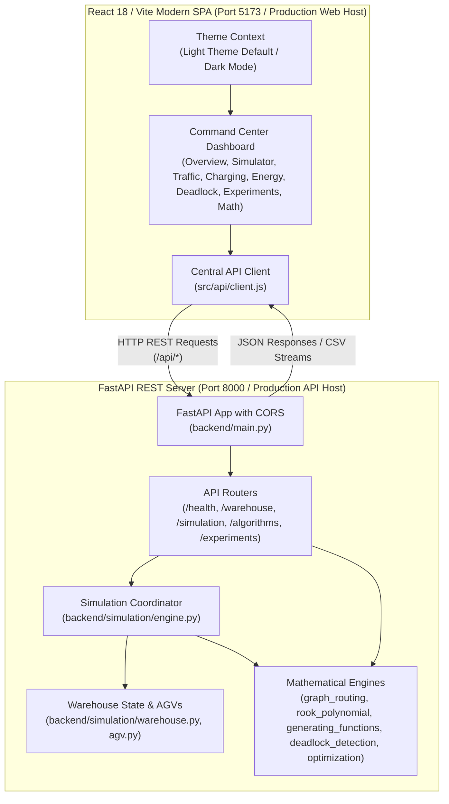

# AGV Intelligence — Project Structure & Architectural Map

**Project Title:** AGV Intelligence — Mathematical Modelling and Optimization of Autonomous Guided Vehicle Traffic Routing and Smart Charging in Automated Warehouses Using Discrete Mathematics  
**Course:** Discrete Mathematics and Graph Theory (Experiential Learning Project)  
**Architecture:** Decoupled Full-Stack Architecture (FastAPI REST Backend + React 18 / Vite Modern SPA Frontend)

---

## 1. Directory Tree Overview

```text
AGV-INTELLIGENCE/
│
├── backend/                             # Python 3.13 FastAPI Backend
│   ├── algorithms/                      # Pure mathematical engines (zero UI/DB coupling)
│   │   ├── __init__.py                  # Algorithm exports
│   │   ├── graph_routing.py             # Planar grid graph G=(V,E), BFS/Dijkstra, conflict graph G_c & Welsh-Powell coloring
│   │   ├── rook_polynomial.py           # Rook polynomial R(x,B) on forbidden boards & PIE alternating sum permutations
│   │   ├── generating_functions.py      # Ordinary Generating Functions (OGFs) & Negative Binomial energy distribution
│   │   ├── deadlock_detection.py        # Directed Wait-For Graph (WFG) D=(V_A, E_W), Tarjan SCC & cycle detection
│   │   ├── optimization.py              # Bipartite matching & Kuhn-Munkres/Hungarian charger dispatch
│   │   └── integrated_controller.py     # Master optimization coordinator combining all mathematical modules
│   │
│   ├── simulation/                      # Multi-agent discrete-time warehouse simulation engine
│   │   ├── __init__.py                  # Simulation exports
│   │   ├── warehouse.py                 # 8x8 warehouse grid digital twin, charging pads, storage racks, obstacle topology
│   │   ├── agv.py                       # AGV state machine, battery dynamics, Manhattan metrics, movement states
│   │   └── engine.py                    # Discrete clock coordinator, step execution, spatial reservation grid
│   │
│   ├── api/                             # FastAPI REST application layer
│   │   ├── __init__.py                  # Router aggregation
│   │   └── routes/                      # Modular API route controllers
│   │       ├── health.py                # System diagnostics, uptime, module status (/api/health)
│   │       ├── warehouse.py             # Warehouse layout, obstacle toggling, grid config (/api/warehouse)
│   │       ├── simulation.py            # Simulation lifecycle (start/pause/step/reset/speed/destination) (/api/simulation)
│   │       ├── algorithms.py            # Execution endpoints for all discrete math algorithms (/api/algorithms)
│   │       └── experiments.py           # 5 reproducible benchmark experiment evaluations & CSV/JSON exports (/api/experiments)
│   │
│   ├── tests/                           # Pytest test suite (77 automated unit & integration tests)
│   │   ├── __init__.py
│   │   ├── test_algorithms.py           # Verification of pure mathematical algorithms
│   │   ├── test_api_integration.py      # End-to-end FastAPI endpoint integration tests
│   │   ├── test_config.py               # Pydantic configuration validation tests
│   │   ├── test_digital_twin.py         # Multi-agent simulation & collision avoidance tests
│   │   ├── test_experiments.py          # Benchmark experiment reproducibility & export tests
│   │   ├── test_generating_functions.py # OGF Diophantine solver & Stars-and-Bars tests
│   │   ├── test_graph_theory.py         # BFS/Dijkstra, conflict graphs & chromatic coloring tests
│   │   ├── test_health.py               # Health diagnostics & route registration tests
│   │   ├── test_integrated_optimization.py # Master controller, deadlock injection & true recovery tests
│   │   └── test_rook_polynomial.py      # Rook polynomial expansion & derangement (!n) tests
│   │
│   ├── config.py                        # Central Pydantic settings (warehouse, fleet, sim, CORS)
│   ├── main.py                          # FastAPI ASGI application entrypoint & middleware configuration
│   ├── requirements.txt                 # Backend Python package dependencies
│   ├── .env.example                     # Backend environment variable template
│   └── .env                             # Local backend environment file (git-ignored)
│
├── frontend/                            # React 18 + Vite Modern Single Page Application (SPA)
│   ├── src/
│   │   ├── api/
│   │   │   └── client.js                # Resilient Fetch API client with timeout & typed error handling
│   │   │
│   │   ├── context/
│   │   │   └── ThemeContext.jsx         # Light/Dark command-center theme provider (defaults to light theme)
│   │   │
│   │   ├── components/                  # Modular React component architecture
│   │   │   ├── common/                  # Reusable status badges, connection indicator pills
│   │   │   │   └── ConnectionStatus.jsx # Real-time backend connectivity & latency monitor
│   │   │   ├── layout/                  # Page shell & navigation chrome
│   │   │   │   ├── TopNav.jsx           # Top header bar, live tick clock, theme toggle, run optimization button
│   │   │   │   ├── Sidebar.jsx          # Clean navigation sidebar with active indicator accents
│   │   │   │   └── NotificationPanel.jsx# Slide-over event & alert audit drawer
│   │   │   ├── ui/                      # High-contrast design system atomic components
│   │   │   │   ├── GlassCard.jsx        # Standardized elevated card surface
│   │   │   │   ├── StatCard.jsx         # KPI summary metric display card
│   │   │   │   ├── Badge.jsx            # Status & taxonomy tag pill
│   │   │   │   ├── Button.jsx           # Primary, outline, ghost, and danger button primitives
│   │   │   │   ├── Tabs.jsx             # Accessible horizontal navigation tab strip
│   │   │   │   └── EmptyState.jsx       # Graceful empty data fallback container
│   │   │   ├── warehouse/               # Interactive digital twin visualizer
│   │   │   │   └── WarehouseGrid.jsx    # SVG 8x8 floor plan, robots, charging docks, storage bays, dynamic paths
│   │   │   ├── fleet/                   # Fleet telemetry & monitoring
│   │   │   │   └── FleetStatus.jsx      # Per-robot telemetry cards, battery percentage gauges, coordinate displays
│   │   │   ├── simulation/              # Simulation control deck
│   │   │   │   └── SimulationControls.jsx # Play, pause, step, reset, and tick speed controls
│   │   │   ├── analytics/               # Visual data telemetry
│   │   │   │   └── AnalyticsPanel.jsx   # Real-time Recharts battery and distance monitoring
│   │   │   └── algorithms/              # Specialized algorithm visualization widgets
│   │   │
│   │   ├── pages/                       # The 8 Full Command Center Modules
│   │   │   ├── OverviewPage.jsx         # Executive command dashboard, KPI strip, objective function tuner
│   │   │   ├── SimulatorPage.jsx        # 8x8 warehouse digital twin simulator & fleet dispatch deck
│   │   │   ├── TrafficControlPage.jsx   # Conflict graph G_c visualizer, Welsh-Powell coloring, BFS/Dijkstra solver
│   │   │   ├── ChargingOptimizationPage.jsx # n x m compatibility matrix, rook polynomials, PIE derivation table
│   │   │   ├── EnergyManagementPage.jsx # OGF power series calculator, negative binomial reduction, power spectrum
│   │   │   ├── DeadlockMonitoringPage.jsx # Directed Wait-For Graph (WFG) SVG canvas & true route detour recovery
│   │   │   ├── ExperimentsAnalyticsPage.jsx # 5 empirical benchmark evaluations, comparative charts, CSV/JSON exports
│   │   │   ├── MathematicsLabPage.jsx   # Theoretical formalism, proofs, theorems, and algorithms
│   │   │   ├── DashboardPage.jsx        # (Legacy view maintained for backward routing compatibility)
│   │   │   ├── SimulationPage.jsx       # (Legacy view maintained for backward routing compatibility)
│   │   │   ├── AlgorithmsPage.jsx       # (Legacy view maintained for backward routing compatibility)
│   │   │   └── AnalyticsPage.jsx        # (Legacy view maintained for backward routing compatibility)
│   │   │
│   │   ├── App.jsx                      # Application root shell, routing state, and real-time polling loop
│   │   ├── main.jsx                     # React DOM root entrypoint wrapped in ThemeProvider
│   │   └── index.css                    # Tailwind CSS directives, CSS custom variables, light/dark styling
│   │
│   ├── index.html                       # HTML5 entrypoint with industrial typography & meta tags
│   ├── vite.config.js                   # Vite bundler configuration & local `/api` reverse proxy
│   ├── tailwind.config.js               # Semantic design token extensions (light mode default + dark class fallback)
│   ├── postcss.config.js                # PostCSS autoprefixer integration
│   ├── package.json                     # Frontend dependencies & npm scripts
│   ├── .env.example                     # Frontend environment variable template
│   └── .env                             # Local frontend environment file (git-ignored)
│
├── documentation/                       # Academic & Technical Documentation
│   ├── mathematical_derivations/        # LaTeX/Markdown formal proofs and theorems
│   ├── experiment_results/              # Reproducible benchmark logs and verification matrices
│   └── screenshots/                     # High-resolution application captures and graph diagrams
│
├── paper/                               # Academic Research Paper (IEEE Conference Format)
│   ├── figures/                         # Vector & raster figures generated from application simulations
│   ├── tables/                          # LaTeX table formatting
│   ├── main.tex                         # Complete IEEE-style LaTeX conference research paper source
│   ├── references.bib                   # Academic bibliography and literature citations
│   ├── paper_ieee.html                  # Standalone formatted HTML paper preview
│   ├── generate_ieee_docx.py            # Automated script compiling paper to IEEE-formatted DOCX
│   ├── generate_html_paper.py           # Automated script rendering HTML paper preview
│   └── generate_paper_diagrams.py       # Script exporting publication-quality figures
│
├── presentation/                        # Faculty presentation materials
│   └── README.md
│
├── report/                              # Comprehensive academic experiential learning report
│   └── README.md
│
├── .gitignore                           # Git ignore rules for Python, Node, OS, IDE, and .env files
├── .env.example                         # Unified repository environment variable template
├── PROJECT_STRUCTURE.md                 # Complete architectural map and directory index (this file)
├── DEPLOYMENT.md                        # Production web hosting guide and configuration instructions
└── README.md                            # Primary project documentation and quick-start guide
```

---

## 2. Mathematical Concept to Code Architecture Mapping

| Mathematical Module | Pure Python Engine | REST API Route | Frontend React Page | Core Mathematical Concept |
| :--- | :--- | :--- | :--- | :--- |
| **Grid Graph & Routing** | `backend/algorithms/graph_routing.py` | `GET /api/algorithms/grid-graph`<br>`POST /api/algorithms/grid-graph/path` | `TrafficControlPage.jsx` | Planar grid graph $G=(V, E)$, unweighted BFS vs weighted Dijkstra shortest path traversal. |
| **Conflict Graph & Coloring** | `backend/algorithms/graph_routing.py` | `GET /api/algorithms/conflict-graph`<br>`POST /api/algorithms/conflict-graph/custom` | `TrafficControlPage.jsx` | Conflict graph $G_c=(V_c, E_c)$ vertex coloring, Welsh-Powell largest-first heuristic, Brooks' Theorem bound $\chi(G_c) \le \Delta(G_c) + 1$. |
| **Rook Polynomials & PIE** | `backend/algorithms/rook_polynomial.py` | `POST /api/algorithms/rook-polynomial` | `ChargingOptimizationPage.jsx` | Generating function of non-attacking rooks $R(x, B) = \sum r_k(B) x^k$ on forbidden board $B$; Principle of Inclusion-Exclusion $N = \sum (-1)^k r_k(B) (n-k)!$; derangements ($!n$). |
| **Generating Functions (OGFs)** | `backend/algorithms/generating_functions.py` | `POST /api/algorithms/backup-energy-distribution` | `EnergyManagementPage.jsx` | Ordinary Generating Functions $G(x) = \frac{x^{mn}}{(1-x)^n}$, Negative Binomial coefficient extraction $[x^R] G(x) = \binom{(R - mn) + n - 1}{n - 1}$, Stars-and-Bars integer partitions. |
| **Deadlock Detection & Recovery** | `backend/algorithms/deadlock_detection.py` | `GET /api/algorithms/deadlock-check`<br>`POST /api/simulation/deadlock/recover` | `DeadlockMonitoringPage.jsx` | Directed Wait-For Graph (WFG) $D=(V_A, E_W)$, Tarjan's Strongly Connected Components (SCC), cycle detection, true Dijkstra detour rerouting. |
| **Bipartite Matching** | `backend/algorithms/optimization.py` | `GET /api/algorithms/optimize-charging` | `ChargingOptimizationPage.jsx` | Weighted bipartite matching between AGVs and charging pads using Kuhn-Munkres (Hungarian algorithm) minimizing Manhattan distance and battery urgency. |
| **Master Controller** | `backend/algorithms/integrated_controller.py` | `POST /api/algorithms/integrated-optimization` | `OverviewPage.jsx` | Multi-objective optimization combining traffic coloring, rook assignment, and energy distribution into a single optimization cycle. |
| **Empirical Experiments** | `backend/simulation/engine.py` | `GET /api/experiments`<br>`GET /api/experiments/{id}` | `ExperimentsAnalyticsPage.jsx` | 5 reproducible benchmarks comparing uncoordinated baseline heuristics against mathematical discrete optimization. |

---

## 3. Communication and Data Flow Architecture



---

## 4. Key Architectural Design Principles

1. **Strict Decoupling of Mathematical Algorithms:**
   All combinatorial, algebraic, and graph-theoretic algorithms reside in `backend/algorithms/` as pure Python modules with zero dependency on FastAPI or database systems. They can be imported, tested, and verified independently.
2. **Single Source of Truth Configuration:**
   `backend/config.py` uses Pydantic Settings to manage warehouse dimensions, fleet specifications, simulation clock durations, and CORS origins with validation and environment variable overrides.
3. **Stateless vs Stateful Boundaries:**
   Mathematical calculations (Rook polynomials, generating functions, graph coloring) are pure and stateless. The warehouse simulation state is encapsulated within `backend/simulation/engine.py` as an in-memory digital twin.
4. **Environment-Agnostic API Client:**
   `frontend/src/api/client.js` reads `VITE_API_URL` dynamically. In local development it defaults to `/api` (proxied by Vite), while in production it points directly to the hosted FastAPI URL.
